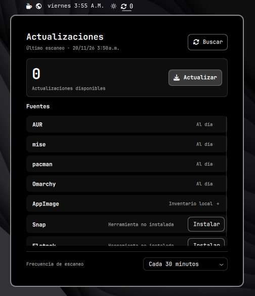

# ElMeGGa OmaUpdate

A status-bar update manager for **Omarchy**. It compares installed and available versions, highlights changed version segments, and opens a floating terminal for updates.



[Update confirmation](screenshots/omaupdate-confirmacion.png) · [Final report and cleanup](screenshots/omaupdate-final.png)

## Install

Requires Omarchy with the Quattro shell and Python 3.11 or newer. Tested on Omarchy 4.5.0-3.

```sh
omarchy plugin add https://github.com/megga-ernesto/omaupdate.git --enable
```

Open the widget from the bar and select **Check** to scan immediately. The default 30-minute scan queries the installed managers over the network. Select **Manual** in the frequency menu to disable automatic scans.

The icon and counter change color as the number of updates grows. Recognized kernel, graphics-driver, and core system packages are flagged as important by package name. This indicator does not evaluate security advisories.

## Terminal command

The widget works without a command on your `PATH`. To make `omaupdate` available in an existing terminal, install an optional user-level link. The command below leaves any existing `~/.local/bin/omaupdate` in place.

```sh
mkdir -p "$HOME/.local/bin"
ln -s -- "${XDG_CONFIG_HOME:-$HOME/.config}/omarchy/plugins/elmegga.omaupdate/omaupdate" "$HOME/.local/bin/omaupdate"
```

If `~/.local/bin` is on your `PATH`, run:

```sh
omaupdate
omaupdate --last-run
```

## Updates, permissions, and cleanup

- The widget scans pacman with `checkupdates` (`pacman-contrib`), AUR with `yay`, and mise with `mise`. Flatpak and Snap are queried when their tools are installed. AppImage support is a local inventory only.
- **Update** presents a plan before running Flatpak user and system updates, Snap refresh, and `omarchy update`. Omarchy handles pacman, AUR, mise, and its own migrations. Missing managers are reported and processing continues.
- **Install** offers the relevant Omarchy package command for a missing manager. Installing Snap uses AUR and enables the snapd socket. Install and update commands can ask for administrator privileges in the terminal.
- Cleanup is offered after the update commands finish without errors. It can prune older pacman cache entries, remove unused Flatpak references, and clear mise caches or remove unused tool versions. Local Steam libraries are only offered for review when Steam appears to be absent. Moving a library to the Trash and permanently emptying the Trash are separate choices.
- The interactive selector uses Gum when available. **Yes** is highlighted by default, including on the Trash prompt. Use the arrow keys to select **No** before pressing Enter to decline.
- The panel and terminal have English and Spanish translations selected from the session locale. The last update report is saved to `${XDG_STATE_HOME:-$HOME/.local/state}/omaupdate/last-run.txt`.

The plugin is an independent community project. It uses Omarchy and the selected package managers on the local machine. Its own code does not send the update report to a remote service.

## Remove

```sh
omarchy plugin remove elmegga.omaupdate
```

If you created the optional command link, remove that specific link:

```sh
cli="$HOME/.local/bin/omaupdate"
target="${XDG_CONFIG_HOME:-$HOME/.config}/omarchy/plugins/elmegga.omaupdate/omaupdate"
if [ "$(readlink -- "$cli")" = "$target" ]; then
  unlink -- "$cli"
fi
```

The saved report is kept in your state directory after removal.

## Credits and license

OmaUpdate code is licensed under the [MIT License](LICENSE). The terminal banner includes a rendering of the Omarchy icon from the [Omarchy project](https://github.com/omacom/omarchy), attributed in [NOTICE](NOTICE.md). Omarchy marks belong to their respective owner. The banner lettering is rendered from JetBrains Mono Nerd Font.
